  

  <a href="https://ognjenadzic.com">ognjenadzic.com</a> ·
  <a href="https://x.com/OgnjenAdzic">X</a> ·
  <a href="https://www.linkedin.com/in/ognjenadzic">LinkedIn</a> ·
  <a href="https://ognjenadzic.substack.com">Substack</a> ·
  <a href="https://www.reddit.com/user/OgnjenAdzic/">Reddit</a> ·
  <a href="mailto:oginjo28@gmail.com">Email</a>

### `~/now`

- **[Invokeable](https://invokeable.com)**: runs real tasks through your product as an agent would, checks what actually changed, and shows you exactly where it broke.
- **[Doorman](https://usedoorman.app)**: my agents kept throwing windows in front of me while I typed, so I made a Mac app that puts mine back.
- **[Hush](https://github.com/OgnjenAdzic28/hush)**: the fastest computer use for AI agents. Drives any desktop app in the background, 178 ms per action.
- **[gnt.ai](https://github.com/gnt-ai/gnt)**: core contributor. Governance for AI agents: versioned policies, PR approval, and runtime checks over MCP.

### `~/before`

- **ArchiStella**: B2B marketplace for maritime procurement. 60 shipping companies, 150+ suppliers and 50,000+ products in beta. Techstars Chicago finalist.
- **PennyOne**: AI assistant for email and scheduling, with Gmail, Calendar, Slack, Notion and more.
- **Pingless**: agency building web, SaaS and AI apps that actually work.

### `~/open-source`

- [Maritime Perception MVP](https://github.com/OgnjenAdzic28/maritime-perception-mvp): water, sky, and obstacle segmentation with vessel tracking and radar demos
- [Autonomous Perception Lab](https://github.com/OgnjenAdzic28/autonomous-perception-lab): KITTI verification, YOLO detection, sparse LiDAR depth, tracking, and BEV replay
- [Agent Workflow Benchmark](https://github.com/OgnjenAdzic28/agent-workflow-benchmark): a benchmark suite for agents working across email, calendar, tasks, memory, and approvals
- [FIFA Momentum Tracker](https://github.com/OgnjenAdzic28/fifa-momentum-tracker): computer vision for spotting momentum shifts and substitution timing in FIFA

### `~/writing`

I write about problems that keep bothering me until I can explain them without hand-waving. Mostly AI, SWE, and whatever I'm learning at the time. [Read on my site](https://ognjenadzic.com/writing) or [Substack](https://ognjenadzic.substack.com).
